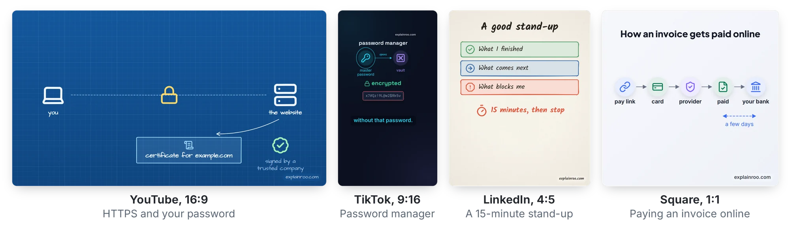
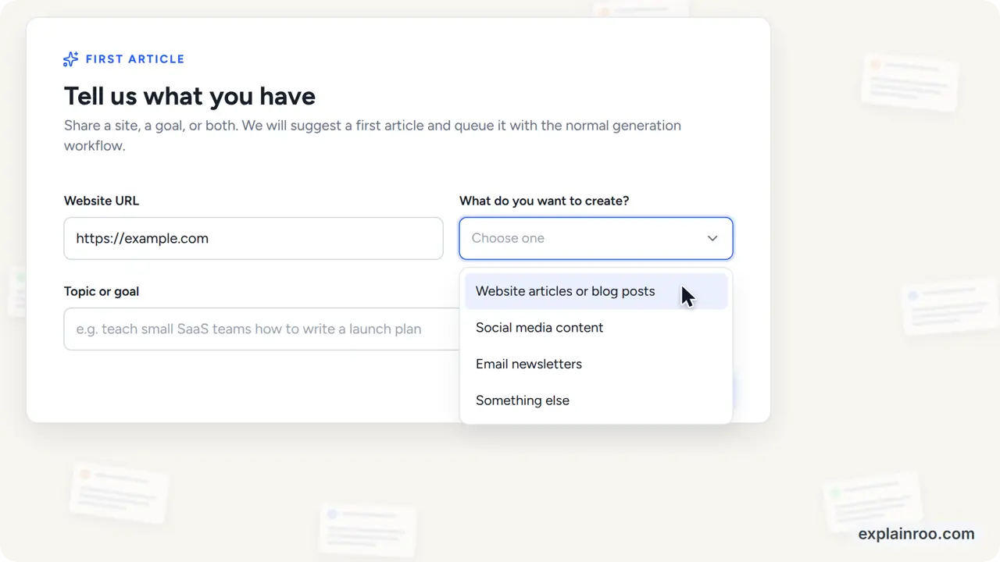

<p align="center">
  <a href="https://www.explainroo.com">
    <picture>
      <source media="(prefers-color-scheme: dark)" srcset="docs/media/logo-dark.png">
      
    </picture>
  </a>
</p>

<p align="center">
  <b>Videos explicativos hechos por tu agente de IA.</b><br>
  Gratis y open source. La voz, el timing y el render corren en tu computadora.
</p>

<p align="center">
  <a href="https://www.explainroo.com">Sitio web</a> &nbsp;·&nbsp;
  <a href="https://www.explainroo.com/videos/">Videos de ejemplo</a> &nbsp;·&nbsp;
  <a href="https://www.explainroo.com/docs/">Documentación</a> &nbsp;·&nbsp;
  <a href="AGENTS.md">AGENTS.md</a>
</p>

> **Réplica en español** del README de [vincentsch/explainroo](https://github.com/vincentsch/explainroo)
> (MIT, Vincent Schmalbach), incluida en el catálogo IMPULSO IA. El original en inglés
> vive en GitHub; este clon traduce README y AGENTS.md para que todo el flujo se lea en
> español. Las skills de los 6 looks están en [`estilos/explicador-*`](../../estilos/LEEME.md)
> del repositorio del catálogo.

https://github.com/user-attachments/assets/6dd5dc32-c975-4e0e-8cd4-2ef3ccc11e61

<p align="center">
  <sub>Un agente de código hizo este video con explainroo. También puedes verlo en <a href="https://www.explainroo.com/videos/how-explainroo-makes-a-video/">explainroo.com</a>.</sub>
</p>

## Novedades

- **20 oct 2026**: [explainroo 0.4.1](https://www.explainroo.com/news/explainroo-0-4-1/) mantiene enteras las etiquetas de flechas y gráficos mientras dura un plano.
- **15 oct 2026**: [explainroo 0.4](https://www.explainroo.com/news/explainroo-0-4/) filma cada escena con una cámara que sigue la narración.
- **13 oct 2026**: [explainroo 0.3](https://www.explainroo.com/news/explainroo-0-3-) narra en japonés y chino mandarín, y añade el look editorial.
- **13 oct 2026**: [explainroo 0.2](https://www.explainroo.com/news/explainroo-0-2-) añade cinco idiomas más, otras voces y clips de video.

Todas las novedades están en [explainroo.com/news](https://www.explainroo.com/news/).

## Haz un video

> [!TIP]
> **Dale este repo a tu agente de código y dile qué debe explicar el video.**
> Funciona con Claude Code, Codex, Pi y otros agentes. Ahora mismo funciona
> mejor con Claude Code y Opus 5.5.

Copia esto en tu agente y pon tu tema en lugar de los corchetes:

```text
Hazme un video explicativo corto sobre [tu tema].
Usa explainroo: usa la copia incluida en este catálogo
(02-explainers/vincentsch--explainroo) o clona https://github.com/vincentsch/explainroo,
lee su AGENTS.md y sigue los pasos.
```

El agente prepara explainroo, hace el video y lo revisa. Recibes un archivo MP4.

## ¿Cómo funciona?

Un video explicativo es un video corto donde una voz explica un tema y dibujos
aparecen mientras habla. Para explainroo, el agente escribe dos archivos.
`script.md` lleva las palabras que dice la voz. `scenes.js` dibuja las imágenes
con un poco de JavaScript, y cada dibujo puede aparecer sobre una palabra del
guion. explainroo hace el resto:

- **Voz.** [Kokoro](https://huggingface.co/hexgrad/Kokoro-82M), un modelo de
  voz abierto, lee el guion en inglés, español, francés, italiano, portugués
  brasileño, hindi, japonés o chino mandarín. Tiene 54 voces y no necesita
  cuenta ni clave de API. También puedes usar una voz de
  [ElevenLabs](https://elevenlabs.io) o grabar la narración tú mismo.
- **Timing.** [Whisper](https://github.com/openai/whisper) escucha la
  narración y anota cuándo se dice cada palabra.
- **Imágenes.** Chrome corre en segundo plano y dibuja los fotogramas. Los
  trazos pueden verse hechos a mano ([Rough.js](https://roughjs.com)), y hay
  1.800 íconos de [Lucide](https://lucide.dev). Una escena también puede
  mostrar gráficos, fórmulas matemáticas, código que cambia paso a paso, tus
  propias capturas de pantalla y clips de video como grabaciones de pantalla.
- **Cámara.** Una cámara filma cada escena. Se acerca a lo que la voz
  menciona cuando hay tiempo, y se aleja al final para que el último
  fotograma muestre la idea completa. Las tarjetas y etiquetas nunca quedan
  cortadas a la mitad mientras dura un plano. Las cosas llegan con un pequeño
  rebote, y el video final tiene desenfoque de movimiento, como una cámara de
  cine.
- **Sonido.** explainroo compone su propia música de fondo para cada video y
  añade pequeños efectos de sonido. La música baja cuando habla la voz.
- **Archivo.** ffmpeg une todo en un MP4, con archivos de subtítulos,
  capítulos de YouTube y una imagen de portada.

Un agente no puede "ver" un video, así que explainroo le da otras formas de
revisar su trabajo. Guarda capturas de las escenas y una hoja de fotogramas
pequeños de todo el video. Una revisión de layout encuentra texto cortado o
superpuesto, y una revisión de habla encuentra palabras que la voz dijo mal.
Para un reproductor de feed, `explainroo check videos/<nombre> --view-width
854` también marca el texto pequeño.

Nada de esto sale de tu computadora y no cuesta nada. Tu agente de código es
un servicio aparte con sus propios términos y precios. Si quieres, el agente
también puede hacer ilustraciones con un modelo de imágenes de IA vía
OpenRouter, y pagas por cada imagen.

## Looks

Hay seis looks: paper, clean, chalk, blueprint, midnight y editorial. Cambias
el look de un video con un ajuste en `video.json`. Un proyecto también puede
traer su propio look: un pequeño archivo JSON con sus colores, fuentes y
fondo. Aquí va un fotograma en cada look integrado, de los videos de ejemplo.

<p align="center">
  <picture>
    <source media="(prefers-color-scheme: dark)" srcset="docs/media/looks-dark.webp">
    
  </picture>
</p>

## Tamaños

Eliges el tamaño según dónde va el video. Los de YouTube son anchos, y Shorts,
TikTok y Reels son verticales. Las publicaciones de Instagram y LinkedIn usan
4:5, y también hay tamaño cuadrado. Shorts, TikTok y Reels ponen sus propios
botones sobre el video, y explainroo mantiene tu texto lejos de esas zonas.

<p align="center">
  <picture>
    <source media="(prefers-color-scheme: dark)" srcset="docs/media/sizes-dark.webp">
    
  </picture>
</p>

Los videos verticales, 4:5 y cuadrados llevan subtítulos que se encienden
palabra por palabra. Un proyecto puede renderizar varios tamaños: `explainroo
render videos/demo --size tiktok` escribe la versión TikTok junto a la ancha.

## Más que un MP4

Cada render también escribe archivos de subtítulos (`.srt` y `.vtt`) que
YouTube y LinkedIn aceptan, una imagen de portada para la miniatura, y
capítulos de YouTube cuando el guion los nombra. `--format gif` hace un GIF
para un README o una publicación. `--transparent --format mov` produce un
video con fondo transparente, para poner un diagrama sobre material filmado
en un editor. `explainroo export` escribe un pequeño reproductor web que
dibuja el video nítido a cualquier tamaño y se incrusta con un iframe.

## Ritmo (pace)

`"pace": 1.2` en el `video.json` hace un 20% más rápida la voz, las pausas y
las animaciones. La música también se acelera un poco. El pace va de 0,7 a
1,6, y 1 es lo normal.

## Demos de producto

explainroo también hace demos de producto, los videos que hacen las empresas
de software para mostrar su app. El agente reconstruye las pantallas de la
app desde su código o su sitio web, con los mismos colores, fuentes y
etiquetas de botones. Un puntero de mouse luego hace clic por las pantallas y
escribe en los campos. Dile a tu agente cuál es el producto y dónde están su
código o su web. `explainroo capture` guarda primero capturas, colores,
fuentes, logo y textos del sitio en vivo, y una grabación real de pantalla
también puede reproducirse dentro de una escena.

<p align="center">
  <a href="https://www.explainroo.com/videos/unspar-product-demo/">
    
  </a>
</p>

Aquí están las demos de [Unspar](https://www.explainroo.com/videos/unspar-product-demo/)
y [Vroni](https://www.explainroo.com/videos/vroni-product-demo/), dos productos
propios del autor. Los archivos de la demo de Unspar están en
[examples/unspar-demo](examples/unspar-demo). explainroo.com también tiene
demos no oficiales de [Gmail, ChatGPT y Claude](https://www.explainroo.com/videos/#product-demos).

## Instálalo tú mismo

Necesitas Node.js 20.11 o más nuevo, ffmpeg, y Chrome o Chromium. La primera
preparación descarga una sola vez los modelos de voz y de timing, unos 400 MB
juntos. No necesitas tarjeta gráfica. El autor desarrolla explainroo en Linux,
y sus tests corren en Linux, macOS y Windows con cada cambio.

```bash
# Desde este catálogo: la copia ya está en 02-explainers/vincentsch--explainroo
# (copia esa carpeta donde trabajes) — o clona el original:
git clone https://github.com/vincentsch/explainroo.git
cd explainroo
npm install
node bin/explainroo.js doctor --fetch
```

Para narrar en español, francés, italiano, portugués o hindi, instala también
[espeak-ng](https://github.com/espeak-ng/espeak-ng), por ejemplo con
`sudo apt install espeak-ng` o `brew install espeak-ng`. Japonés y chino
necesitan Python con [misaki](https://github.com/hexgrad/misaki), como se
describe en [AGENTS.md](AGENTS.md#japonés-y-chino).

Luego inicia tu agente en la carpeta `explainroo` y pide un video, por
ejemplo: «Haz un video de 60 segundos sobre cómo HTTPS mantiene secreta una
contraseña». El agente sigue [AGENTS.md](AGENTS.md) y guarda el video en
`videos/<nombre>/out/video.mp4`. Los videos de ejemplo están en
[examples/](examples/), y la documentación completa en
[explainroo.com](https://www.explainroo.com/docs/).

## La marca de agua

Cada video lleva un pequeño «explainroo.com» en una esquina. `"watermark":
false` en `video.json` la apaga. Consérvala si puedes: así es como otra gente
encuentra explainroo.

## Créditos y licencia

explainroo es MIT. La voz viene de
[Kokoro](https://huggingface.co/hexgrad/Kokoro-82M) y el timing de palabras de
[Whisper](https://github.com/openai/whisper) vía
[Transformers.js](https://github.com/huggingface/transformers.js). Los
dibujos usan [Rough.js](https://roughjs.com) e íconos de
[Lucide](https://lucide.dev). [MathJax](https://www.mathjax.org) compone las
fórmulas. [Playwright](https://playwright.dev) maneja Chrome y
[ffmpeg](https://ffmpeg.org) arma el video. Para otros idiomas, explainroo
ejecuta [espeak-ng](https://github.com/espeak-ng/espeak-ng) como programa
aparte, con reglas de fonemas de [misaki](https://github.com/hexgrad/misaki)
(la biblioteca con la que se entrenaron las voces de Kokoro), y misaki mismo
para japonés y chino. [OpenCC](https://github.com/nk2028/opencc-js) y
[pinyin-pro](https://github.com/zh-lx/pinyin-pro) ayudan a la revisión de
habla con chino, y [HarfBuzz](https://github.com/harfbuzz/harfbuzzjs)
mantiene pequeñas las fuentes del reproductor web. Las fuentes, incluida Noto
Sans CJK para japonés y chino, están bajo la SIL Open Font License.
